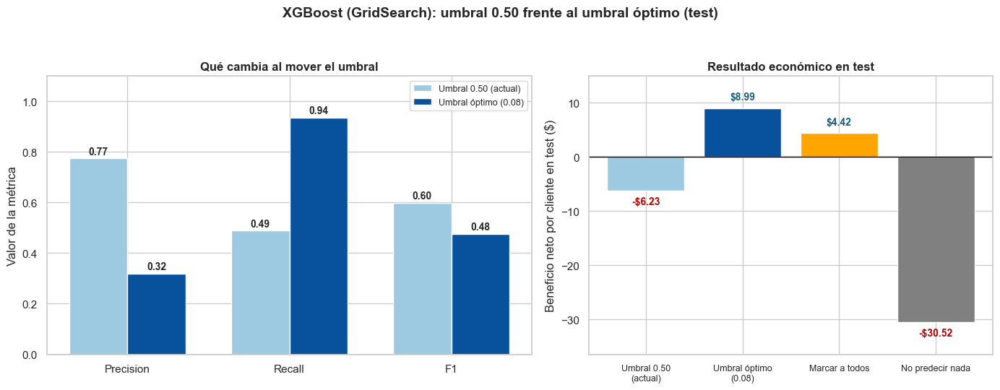
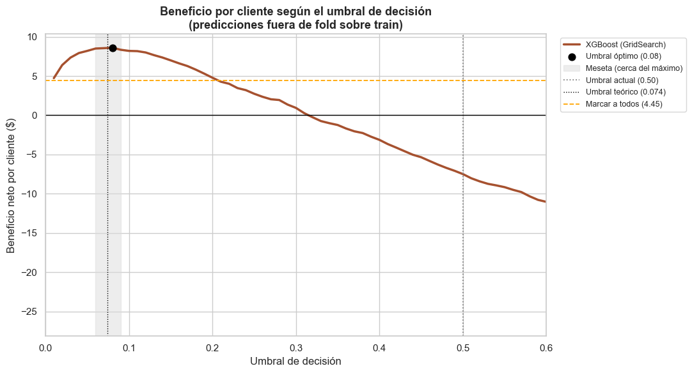
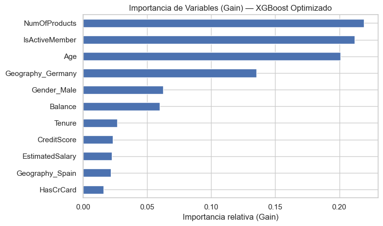
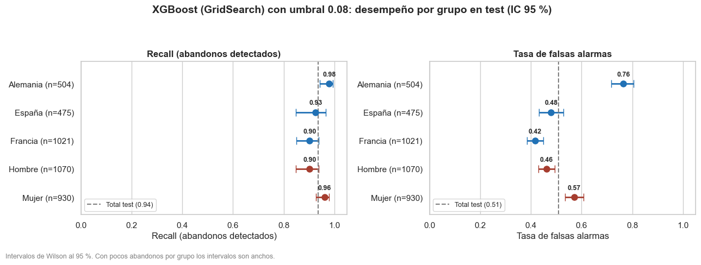
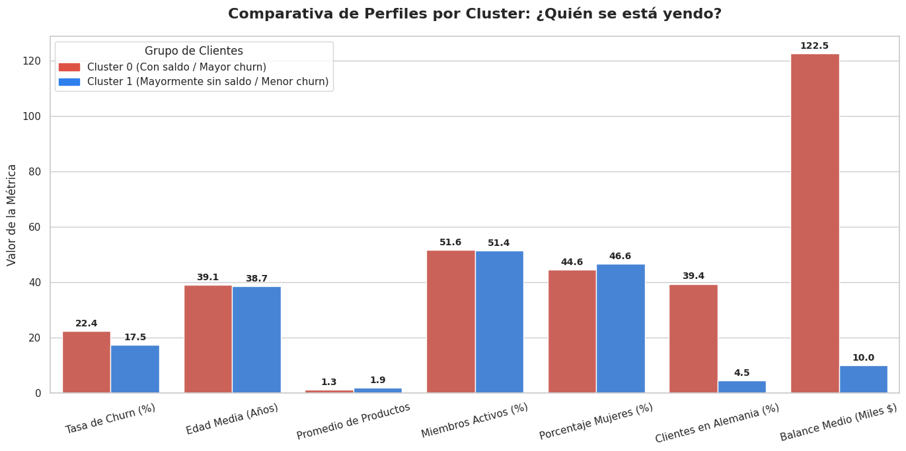

# FinanceGuard · Predicción y segmentación de la fuga de clientes (churn)

Análisis de abandono (churn) de extremo a extremo en un conjunto de datos de banca minorista de 10,000 clientes: un modelo base de regresión logística interpretable, optimización de gradiente (XGBoost, LightGBM, CatBoost) con ajuste de hiperparámetros, un umbral de decisión basado en costos comerciales con intervalos de confianza de bootstrap, y segmentación de clientes no supervisada (K-Means, PCA, DBSCAN, t-SNE).

> **English summary:** End-to-end churn analysis on a 10,000-customer retail-banking dataset: an interpretable logistic-regression baseline, gradient boosting (XGBoost, LightGBM, CatBoost) with hyperparameter tuning, a business-cost-based decision threshold with bootstrap confidence intervals, and unsupervised customer segmentation (K-Means, PCA, DBSCAN, t-SNE). Notebooks and documentation are in Spanish.


## Resumen

Un banco digital pierde **1 de cada 5 clientes (20,4 %)**. Este proyecto responde tres preguntas:

1. ¿Qué factores se asocian al abandono y qué tan bien se puede predecir?
2. ¿Cuánto mejoran los modelos de Gradient Boosting y cómo se traduce en dinero?
3. ¿Existen segmentos naturales de clientes?

**Hallazgos principales**

- **Los ensambles superan claramente al baseline.** El ROC-AUC en test pasa de 0,775 (regresión logística) a 0,865–0,870. XGBoost, LightGBM, CatBoost y el Stacking son equivalentes entre sí (diferencias menores que el desvío entre folds).
- **El umbral de decisión pesa más que el algoritmo.** Con costos supuestos (+100 por acierto, −150 por abandono no detectado, −20 por falsa alarma), el umbral por defecto (0,5) pierde **6,23 USD por cliente** y el umbral óptimo (0,08, elegido por validación cruzada) gana **8,99 USD por cliente**, frente a 4,42 de marcar a todos los clientes. La ventaja sobre esa regla trivial es de +4,57 USD (IC 95 %: 3,19 a 5,79).
- **Las falsas alarmas no se reparten igual.** Con el umbral óptimo el recall es parejo entre grupos (0,90–0,98), pero la tasa de falsas alarmas es de 0,76 en Alemania frente a 0,42 en Francia, y de 0,57 en mujeres frente a 0,46 en hombres.
- **La segmentación es débil.** K-Means con K=2 separa a los clientes con saldo de los que mayormente no tienen saldo (churn de 22,4 % frente a 17,5 %), pero la silueta es baja (0,15): los segmentos son tendencias, no grupos nítidos.

## Datos

Dataset de churn bancario con **10.000 clientes y 14 columnas** (perfil demográfico, saldo, productos, actividad) y la variable objetivo `Exited` (1 = abandonó). La tasa de abandono es del 20,37 % (2.037 clientes). Se trabaja con una partición estratificada 80/20: 8.000 clientes para entrenar y 2.000 para test (407 abandonos).

Los archivos se encuentran en: [`data/Churn_Modelling.csv`](data/Churn_Modelling)  [`data/Churn_Modelling_limpio.csv`](data/Churn_Modelling Limpio).

## Contenido del repositorio

| Notebook | Qué hace | Resultado clave |
|---|---|---|
| [`1_EDA_RegresionLogistica`](notebooks/1_EDA_RegresionLogistica.ipynb) | EDA, preparación de variables y regresión logística como baseline interpretable (odds ratios, VIF, intervalos de confianza) | ROC-AUC 0,775; recall de abandono 0,19 con umbral 0,5 y 0,70 con pesos de clase balanceados |
| [`2_GradientBoosting_Optimizacion`](notebooks/2_GradientBoosting_Optimizacion.ipynb) | Comparación de modelos con validación cruzada, optimización con GridSearchCV y RandomizedSearchCV, evaluación en test, umbral óptimo según la métrica de negocio, bootstrap y análisis por grupo | XGBoost optimizado: ROC-AUC 0,869; beneficio por cliente de −6,23 a +8,99 al ajustar el umbral |
| [`3_AprendizajeNoSupervisado`](notebooks/3_AprendizajeNoSupervisado.ipynb) | K-Means, PCA, DBSCAN y t-SNE sin usar la etiqueta; cruce posterior de los segmentos con el churn | Dos segmentos con churn de 22,4 % y 17,5 % (diferencia significativa pero moderada) |

La carpeta [`reports/`](reports/) incluye la presentación del proyecto.

## Resultados

### Comparación de modelos (conjunto de test)

| Modelo | ROC-AUC | PR-AUC | F1 (umbral 0,5) |
|---|---|---|---|
| Regresión logística (baseline) | 0,775 | 0,479 | 0,284 |
| Random Forest | 0,865 | 0,707 | 0,564 |
| XGBoost | 0,865 | 0,712 | 0,602 |
| LightGBM | 0,865 | 0,709 | 0,591 |
| CatBoost | 0,870 | 0,727 | 0,615 |
| Stacking (XGBoost + LightGBM + CatBoost) | 0,870 | 0,726 | 0,614 |
| XGBoost (GridSearchCV) | 0,869 | 0,717 | 0,599 |
| XGBoost (RandomizedSearchCV) | 0,870 | 0,720 | 0,600 |

En validación cruzada (5 folds) la regresión logística obtiene 0,763 y los ensambles entre 0,859 y 0,868, con un desvío de ≈ 0,01. Se eligió **XGBoost** por su bajo costo de entrenamiento (el Stacking es unas 15 veces más lento sin una mejora distinguible) y **GridSearchCV** por requerir menos ajustes que la búsqueda aleatoria con un resultado equivalente.

### El umbral de decisión

| Test (XGBoost con GridSearchCV) | Umbral 0,50 | Umbral óptimo 0,08 |
|---|---|---|
| Recall (abandonos detectados) | 0,49 | 0,94 |
| Falsas alarmas | 58 | 811 |
| Clientes marcados | 12,9 % | 59,6 % |
| **Beneficio por cliente (USD)** | **−6,23** | **+8,99** |

Referencias por cliente: marcar a todos = +4,42; no predecir nada = −30,52.





El umbral se eligió con predicciones fuera de fold sobre el conjunto de entrenamiento y se aplicó **una sola vez** sobre test. La regla teórica `costo_FP / (costo_FP + ganancia_TP + pérdida_FN)` ≈ 0,074 queda muy cerca del óptimo empírico.

### Variables que usa el modelo



Lideran `NumOfProducts`, `IsActiveMember`, `Age` y `Geography_Germany`, en línea con los odds ratios del baseline. `NumOfProducts` no es lineal: abandonan el 27,7 % de los clientes con 1 producto, el 7,6 % con 2, el 82,7 % con 3 y el 100 % con 4 (60 clientes).

### Desempeño por grupo



### Segmentación no supervisada



- **K-Means (K=2):** cluster con saldo (59,1 % de la cartera, churn 22,4 %) y cluster mayormente sin saldo (40,9 %, churn 17,5 %). Silueta 0,15.
- **PCA:** las dos primeras componentes explican el 33,1 % de la varianza; PC1 contrapone `Balance` frente a `NumOfProducts`.
- **DBSCAN:** un único grupo denso y 37 clientes atípicos (0,4 %); 31 de ellos tienen 4 productos y el 94,6 % abandonó.

## Cómo reproducirlo

```bash
git clone https://github.com/<tu-usuario>/financeguard-churn.git
cd financeguard-churn

python -m venv .venv
# Windows:        .venv\Scripts\activate
# macOS / Linux:  source .venv/bin/activate

pip install -r requirements.txt
# Colocar Churn_Modelling.csv en la carpeta data/ (ver data/README.md)

jupyter lab
```

1. Ejecutar los notebooks **en orden** (1 → 2 → 3) desde la carpeta `notebooks/`. Los tres leen el CSV con una ruta relativa (`../data/`).
2. El Avance 1 genera `data/Churn_Modelling_limpio.csv` (variables codificadas).
3. La semilla es `RANDOM_STATE = 42` en todo el proyecto. El Avance 2 puede tardar varios minutos (el Stacking es lo más lento) y los tiempos de entrenamiento dependen del equipo.

Desarrollado y ejecutado con Python 3.14 y scikit-learn 1.8. `requirements.txt` fija solo versiones mínimas; si querés reproducir exactamente tu entorno, generá un archivo de versiones con `pip freeze`.

## Decisiones metodológicas

- **El test se usa una sola vez**, como confirmación; ni el modelo ni el umbral se eligen mirando ese conjunto.
- **Sin fuga de datos:** el escalado y la codificación van dentro de un `Pipeline` y se ajustan solo con los datos de entrenamiento en cada fold.
- **Comparación pareja:** mismos folds para todos los modelos, un hilo por modelo para medir tiempos y comparación contra reglas triviales (marcar a todos / no predecir nada).
- **Incertidumbre explícita:** bootstrap sobre los clientes de test (2.000 remuestreos) para el beneficio por cliente y sus diferencias; intervalos de Wilson para las métricas por grupo.
- **Optimización sobre ROC-AUC**, una métrica que no depende del umbral.

## Limitaciones

- Los **costos** (+100, −150, −20) son supuestos: los montos en dólares son ilustrativos y la conclusión robusta es cualitativa (el umbral óptimo es mucho menor que 0,5).
- El dataset es **estático y sin fecha**: no permite validación temporal ni detección de *drift*.
- `Geography` y `Gender` son entradas del modelo. Las falsas alarmas difieren por grupo, por lo que conviene vigilar el desempeño por grupo y evaluar si deben seguir como variables.
- Los odds ratios, la importancia de variables y los clusters describen **asociaciones, no causas**.
- Los segmentos del Avance 3 son débiles (silueta 0,15).

## Tecnologías

Python · pandas · NumPy · scikit-learn · XGBoost · LightGBM · CatBoost · statsmodels · SciPy · Matplotlib · Seaborn · Jupyter

## Autora

**Jessica Torres** · Consultora de datos (Power BI, SQL y Python) con formación en Data Science y Machine Learning.
[LinkedIn](https://www.linkedin.com/in/<tu-perfil>) · [Correo](mailto:<tu-correo>)
